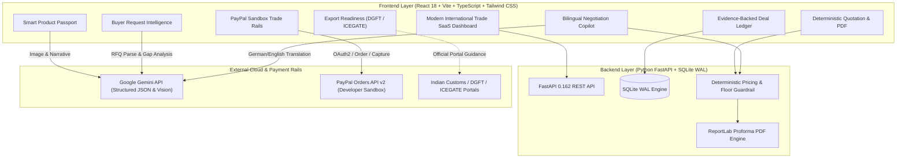

# BORDERLESS AI — AI Export Copilot for Indian Artisans & Small Manufacturers

> **Empowering Indian handloom clusters, handicraft makers, and small manufacturers to convert product information and international buyer enquiries into structured, evidence-backed export deals and verified PayPal Sandbox milestone payments.**

---

## 🌟 Executive Summary & Project Vision

**BORDERLESS AI** is not a generic ecommerce marketplace and not a superficial chatbot. It is a specialized, production-ready **Export Deal Intelligence Copilot** specifically designed for first-time Indian exporters (demonstrated with **Kaveri Looms**, an artisan handloom business in the Erode Handloom Cluster, Tamil Nadu).

### 🎯 Core Differentiator: Evidence-Backed Deal Intelligence
In global trade, hallucinations kill deals and create catastrophic export compliance penalties. BORDERLESS AI enforces strict parameter-level accountability:
* Every deal detail carries an immutable **Source**: `seller-provided`, `buyer-requested`, `externally-verified`, `ai-suggested`, or `missing-unverified`.
* Every deal detail has a strict **Verification Status**: `verified`, `pending_confirmation`, `discrepancy`, or `unverified`.
* **Zero Hallucination Guarantee:** The system distinguishes facts from suggestions. It **never fabricates** production costs, certifications, buyer identities, shipping rates, or legal approvals.
* **Deterministic Pricing:** LLMs are **strictly prohibited** from calculating final payable amounts. All quotations are calculated deterministically in backend Python code based on confirmed artisan costs, volume allocations, and mandatory price floors.

---

## 🏛️ System Architecture



---

## 🚀 Core Modules & Features

| # | Module | Capability & Technical Implementation |
|---|---|---|
| **1** | **Seller Dashboard & Profile** | Manages business identity for *Kaveri Looms*, Erode, Tamil Nadu (IEC, GSTIN with LUT, AD Code, Bank Details). |
| **2** | **Smart Product Passport** | Multi-modal Gemini extraction (vision & text) for export titles, materials, dimensions, weight, and HS codes. Extracted items remain tagged as *AI-suggested* until confirmed by the seller. |
| **3** | **Buyer Request Intelligence** | Parses raw buyer RFQs (tested with *Hanseatische Wohnkultur GmbH*, Hamburg, Germany). Flags missing parameters (EORI, packaging, freight forwarder nominations). |
| **4** | **Evidence-Backed Deal Intelligence** | The core differentiator: evaluates 11 critical parameters across buyer, cost, logistics, compliance, and payment. Computes an Information Completeness Index (not a legal certification). |
| **5** | **Intelligent Export Quotation** | Pure deterministic backend calculations. Enforces a 15% minimum livelihood margin floor. Produces itemized transparent costs and generates a downloadable ReportLab Proforma PDF. |
| **6** | **Global Negotiation Assistant** | Translates German/English buyer discount requests, deterministically recalculates retained margin and batch profit, and drafts native bilingual counter-proposals with volume locks. |
| **7** | **PayPal Trade Checkout** | Server-side integration with **PayPal Orders API v2 (Sandbox)**. Orders generated only upon seller approval, captured server-side, and verified against PayPal API references. |
| **8** | **Export Readiness Checklist** | Monitors statutory readiness: IEC, PAN, GSTIN, AD Code port registration, ITC-HS 6304.92, EU REX origin declarations, and REACH chemical standards with official DGFT/ICEGATE links. |
| **9** | **Deal Audit Dashboard** | Real-time export metrics, timeline audit trail, and live system status indicators. |

---

## ⏱️ 3-Minute Hackathon Demonstration Workflow

Follow this battle-tested presentation sequence:

1. **Step 1: Smart Product Passport (0:00 - 0:40)**
   * Open *Product Passports* tab.
   * Click **New Product Passport**. Click **Paste Demo Cushion Spec** (Erode handloom cotton cushion cover).
   * Click **Run Gemini Structured Extraction**.
   * Highlight the yellow **AI Suggested (Unconfirmed)** tags. Show that the artisan retains authority to verify before saving.

2. **Step 2: Buyer Request Intelligence (0:40 - 1:15)**
   * Open *Buyer Enquiries* tab.
   * Click **Load Sample German RFQ** (Greta Lindemann, Hanseatische Wohnkultur GmbH, Hamburg).
   * Click **Extract Trade Parameters**.
   * Show that the AI identified 4 missing critical details (EORI number, forwarder nomination) and generated 3 clarifying questions.
   * Show the honest honesty banner: *Unverified Buyer Identity — Requires Due Diligence*.

3. **Step 3: Evidence-Backed Deal Intelligence (1:15 - 1:50)**
   * Open *Deal Intelligence* tab.
   * Point out the **Information Completeness Index (72%)** and the explicit disclaimer.
   * Walk through the table showing **Source** (*seller-provided*, *buyer-requested*, *externally-verified*, *ai-suggested*, *missing-unverified*).
   * Click **Verify** on a pending parameter to show live status transition.

4. **Step 4: Deterministic Quotation & PDF (1:50 - 2:20)**
   * Open *Quotations* tab.
   * Adjust the margin slider: show that the backend mathematically prevents quoting below the seller-approved price floor (€4.46).
   * Show the itemized transparent breakdown (€5.24 / unit FOB Chennai, €524.00 total).
   * Click **Download Proforma PDF** to view the generated document.

5. **Step 5: German Negotiation & Margin Impact (2:20 - 2:40)**
   * Open *AI Negotiation* tab.
   * Click **Load German RFQ Counter-Offer** (buyer asking for €4.85 with promise of 500 units in July).
   * Click **Analyze Financial Margin Impact**.
   * Show that the backend calculates profit retained (₹8,877) and margin (20.0%), confirms it is above the floor, and generates a native German counter-offer proposal.

6. **Step 6: PayPal Sandbox Trade Checkout (2:40 - 3:00)**
   * Open *PayPal Checkout* tab.
   * Click **Generate PayPal Sandbox Order**.
   * Click **Simulate Buyer Approval & Capture Funds**.
   * Show the real-time verified transaction receipt with the PayPal Sandbox Order ID, Capture ID, and database status updated to **PAID**.

---

## 🛠️ Technology Stack

* **Frontend:** React 18, Vite 6, TypeScript 5.7, Tailwind CSS 3.4, Lucide React icons.
* **Backend:** Python 3.12, FastAPI 0.162, Uvicorn, Pydantic v2, HTTPX.
* **Database:** SQLite3 with Write-Ahead Logging (`WAL`) mode for robust concurrent access.
* **Document Engine:** ReportLab 5.1 (clean typography, itemized tables, disclaimers).
* **AI Engine:** Google Gemini API (`gemini-2.5-flash`) with strict Pydantic JSON schemas and deterministic demo mode fallback.
* **Payment Rails:** PayPal Orders API v2 (Sandbox Mode) with server-side authorization and capture.

---

## 📦 Setup & Installation Instructions

### Prerequisites
* **Node.js** (v18+ or v22 LTS) & **npm**
* **Python** 3.10+ with `pip`

### 1. Clone & Enter Directory
```bash
git clone https://github.com/your-username/borderless-ai.git
cd borderless-ai
```

### 2. Configure Environment Variables
Copy `.env.example` to `backend/.env` (or project root):
```bash
cp backend/.env.example backend/.env
```
Fill in your credentials (or leave empty to run in deterministic demo fallback mode):
```env
GEMINI_API_KEY=your_gemini_api_key_here
PAYPAL_CLIENT_ID=your_paypal_sandbox_client_id
PAYPAL_CLIENT_SECRET=your_paypal_sandbox_client_secret
PAYPAL_BASE_URL=https://api-m.sandbox.paypal.com
```

### 3. Install Backend Dependencies
```bash
cd backend
pip install -r requirements.txt
cd ..
```

### 4. Install Frontend Dependencies & Build
```bash
cd frontend
npm install
npm run build
cd ..
```

### 5. Run Backend Verification Test Suite
```bash
python backend/tests/test_api.py
```
*(All 16 acceptance criteria tests will execute and pass)*

### 6. Start the Application
To run the full stack server (FastAPI serves both the API and the pre-built React Single Page Application on port 8000):
```bash
python backend/run.py
```
Open your browser and navigate to:
👉 **`http://localhost:8000`**

To run the Vite development server with hot-module replacement:
```bash
cd frontend
npm run dev
```
Open: **`http://localhost:5173`** (proxies `/api` to port 8000).

---

## 📡 API Reference Documentation

When the backend is running, complete interactive OpenAPI documentation is available at:
👉 **`http://localhost:8000/docs`**

### Key Endpoints:
* `GET /api/auth/me`: Active seller profile (*Kaveri Looms*).
* `GET /api/products`: List Smart Product Passports.
* `POST /api/products/ai-extract`: Extract structured passport attributes using Gemini.
* `POST /api/enquiries/extract`: Parse raw buyer RFQs and detect missing details.
* `GET /api/deal/{enquiry_id}`: Full Evidence-backed Deal Intelligence ledger and completeness score.
* `PATCH /api/deal/fields/{field_id}`: Update deal field verification status.
* `POST /api/quotations/calculate`: Deterministic export quotation calculation preview.
* `POST /api/quotations`: Save seller-approved quotation.
* `GET /api/quotations/{id}/pdf`: Download ReportLab export proforma quotation PDF.
* `POST /api/negotiation/analyze`: Translate buyer message and calculate margin impact.
* `POST /api/paypal/create-order`: Generate PayPal Sandbox Orders API v2 order.
* `POST /api/paypal/capture-order`: Capture and verify payment server-side.
* `GET /api/readiness`: Indian statutory compliance checklist (IEC, GSTIN, AD Code, DGFT).
* `GET /api/dashboard/stats`: High-level export metrics and system health.

---

## 🔒 Security & Data Integrity

1. **Client Isolation:** PayPal client secret and Gemini API keys are **never** exposed to frontend JavaScript code.
2. **Server-Side Verification:** Payment completion requires cryptographic capture confirmation directly from the PayPal API. Frontend success events are never trusted.
3. **No Hallucinated Financials:** All price totals, margins, conversion rates, and profit impacts are calculated deterministically in backend Python code.
4. **Prompt Injection Protection:** Untrusted buyer text and uploaded images are treated strictly as isolated data payloads inside structured system prompts.
5. **No Card Data Stored:** No credit card numbers or raw banking tokens are collected or stored in the database.

---

## ⚠️ Known Limitations & Disclaimers

* **Demonstration Data:** All records for *Kaveri Looms*, *Ramesh Kumar*, and *Hanseatische Wohnkultur GmbH* are strictly fictional demo records created for hackathon demonstration.
* **Sandbox Mode:** All payments are processed through PayPal Sandbox developer accounts; real currency is never transacted.
* **Not Legal Advice:** The *Export Readiness Checklist* and *Information Completeness Indicator* provide operational guidance and do not replace legal or customs counsel from a licensed Customs House Agent (CHA) or the Indian Directorate General of Foreign Trade (DGFT).

---

## 🏆 Hackathon Project Credits
* Developed for **PayPal Hackathon 2025**.
* Project Lead & Architecture: Full-Stack AI Engineer & Trade Technology Mentor.
